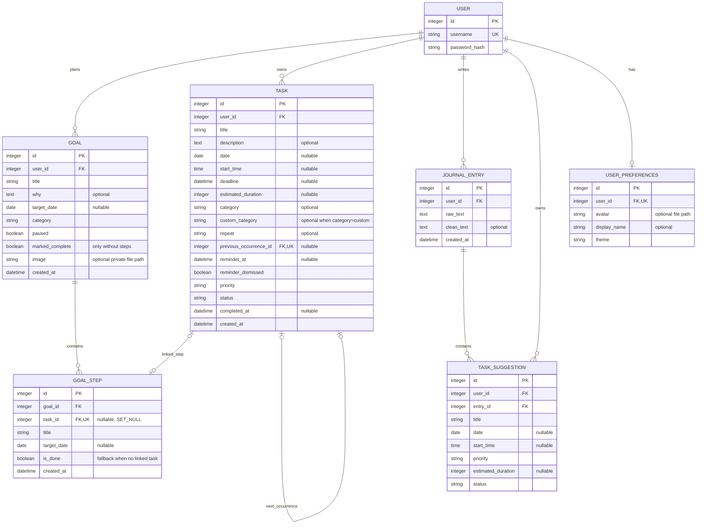

# Design

## Final ERD



Every task/entry/suggestion has exactly one owner. Preferences are optional until first needed, then unique per user. Owner and journal-entry foreign keys use CASCADE; the repeating-task self-reference uses SET_NULL. An accepted task is independent of its originating suggestion; removing a journal does not remove that task. The duplicated suggestion owner supports ownership checks, but the view must keep it consistent with the entry owner; this consistency is not a database constraint. Django owns username uniqueness and password hashing. The model defaults and choice fields represent priority/status; form validation enforces allowed task values and duration bounds. Task categories include fixed choices plus a validated custom name. Completed tasks are filtered out of the default active query and remain stored for the archive and reports. The optional unique self-reference permits at most one generated next occurrence per task; SET_NULL preserves successors if the predecessor is removed. Uploaded avatar and goal-image paths are stored in their owner-scoped records; image bytes remain outside the database. No many-to-many relationship is needed.

Goals and steps are ordinary owner-scoped records, outside the optional journal encryption boundary. Goal images are returned only through an authenticated owner-filtered endpoint. A linked task supplies the step completion state; deleting it preserves the last state in `is_done`. Deleting a goal cascades to its steps, without deleting linked tasks. [Goal details](goals.md).

## Wireframes

- Goals: short title form → optional reason/date → milestone timeline and filters → steps and progress → optional task links.
- Tasks: heading → search/status/priority controls → Add Task → cards with edit/delete/complete → pagination.
- Add Task: title → optional date → collapsible optional details → Save / AI suggestion / Cancel. AI results open the details for review.
- Journal: search → New Entry → date, excerpt and pending count on each entry → open/edit/delete → pagination.
- Journal detail: saved text → pending suggestions → accept/dismiss. Edit explains how obsolete suggestions are handled.
- Achievements: week/month/year tabs → date range → percentage and progress → completed/remaining/total → metric explanation.

### Simple screen wireframes

```text
TASKS                              ADD TASK
+----------------------------+     +----------------------------+
| Mawj                  Menu |     | Mawj                  Menu |
| My Tasks      [+ Add Task] |     | Add Task                   |
| Search [_________________] |     | Title [__________________] |
| Status [All] Priority [All]|     | Date  [optional__________] |
| [Filter]  Clear filters    |     | > Additional details       |
| Task title / status       |     | [Save] [AI suggestion]     |
| [Edit] [Delete] [Complete] |     | Cancel                     |
| Previous   Page 1   Next   |     +----------------------------+
+----------------------------+

JOURNAL                            ACHIEVEMENTS
+----------------------------+     +----------------------------+
| My Journal    [+ New Entry]|     | Achievements               |
| Search [________] [Search] |     | [Week] [Month] [Year]      |
| Date / saved text excerpt |     | Selected date range        |
| 2 pending suggestions     |     |            50%             |
| Open / Edit / Delete      |     | [========        ]         |
| Date / another excerpt    |     | Completed Remaining Total  |
| 0 pending suggestions     |     |     6         6      12    |
| Previous / Next           |     | How this is calculated     |
+----------------------------+     +----------------------------+
```

## Journeys

1. Sign up → create a journal with action lines → inspect suggestions → accept one → find it in Tasks → mark done → inspect achievements.
2. Add a task with only a title → optionally request AI suggestions → review → save → search/filter → edit or delete with confirmation.
3. Edit a journal → pending suggestions are dismissed → previously accepted tasks remain → delete entry after reviewing consequences.

Responsive design wraps controls on narrow screens; wide calendar content scrolls in its own labeled region. Forms use associated labels, and period navigation identifies the selected link. Visual/mobile checks are recorded separately from automated tests.

## Additional journeys

- Profile → upload photo → inspect private resized avatar → remove → default avatar returns.
- Add task → optional category/repeat/reminder → complete → successor created once → inspect Today sections and category filters.
- Open a page after reminder time → reminder banner → Today → dismiss reminder.
- Achievements → choose period → compare completed/remaining bars → expand exact data table.

## Next.js visual system

The Next.js landing page introduces Mawj’s journal-to-task workflow through a large editorial hero, an explicitly illustrative app preview, a sequential workflow, a journal example and a focused signup action. The workspace uses horizontal navigation, compact task rows, optional inline forms and calm summary panels rather than long lists of empty fields. English uses DM Sans for interface text and Fraunces for editorial headings; Arabic uses Noto Sans Arabic for text and the supplied Saudi font for headings. Keyboard focus, reduced motion, loading skeletons, empty states, inline errors and destructive-action confirmations are included.

Five themes are Grove (green), Petal (pink/lavender/blue), Dusk (mauve/ink), Ember (light surfaces with crimson accents), and Midnight (dark). The duplicated green URL maps to one theme. Additional neutral surfaces and readable foreground colors complement the exact supplied palette tokens. Theme preferences persist to Django for signed-in users and to local storage for anonymous browsing. This redesign changes presentation and adds a session API; the existing entities, relationships and business rules remain in Django.

See [the new interface](nextjs.md) for routes, setup and architecture, and [Grove visual preview](previews/landing-grove.png).
